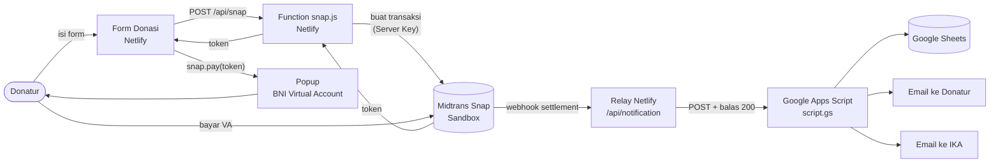
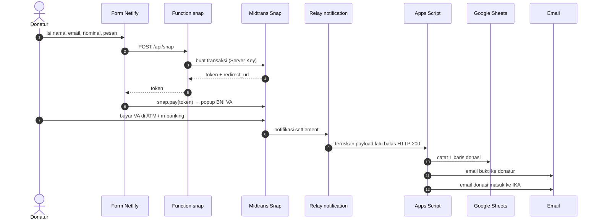
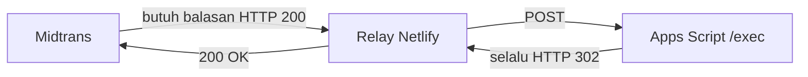
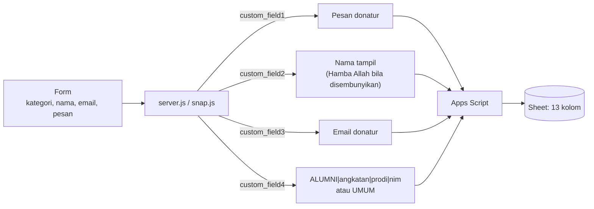
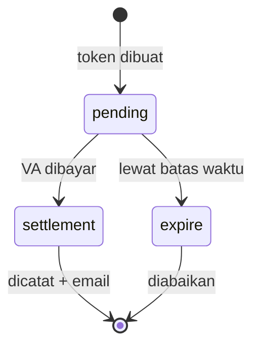
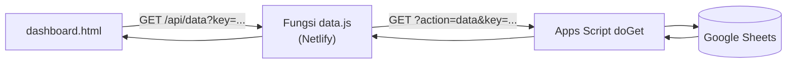

# Beasiswa Ikatan Alumni

Form donasi online untuk program beasiswa Ikatan Alumni.
Donatur mengisi kategori, nama, email, nominal, dan pesan → memilih **BNI Virtual Account**
lewat **Midtrans Snap** → setelah dibayar, data otomatis masuk **Google Sheets** dan dua
**email** terkirim (ke donatur dan ke pengelola).

**Minimal donasi Rp10.000.** Nominal cepat tersedia: 25rb / 50rb / 100rb / 250rb,
atau isi manual. Halaman depan menampilkan total dana terkumpul, target, dan jumlah
donatur dari endpoint publik `GET /api/summary`.

| | |
|---|---|
| **Form donasi (publik)** | https://donasi-beasiswa-ika-upi.netlify.app |
| **Dashboard data** | https://donasi-beasiswa-ika-upi.netlify.app/dashboard.html |
| **Relay notifikasi (Midtrans)** | https://relay-donasi-ika-upi.netlify.app/api/notification |
| **Repositori** | https://github.com/madgeer/portal-beasiswa-ika |
| **Mode** | Midtrans **Sandbox** |

---

## 1. Gambaran Program



**Inti idenya:** browser tidak pernah menyentuh Server Key. Browser hanya minta token ke
backend kecil, lalu Midtrans yang mengabari backend saat pembayaran selesai.

---

## 2. Alur Donasi (Sequence)



---

## 3. Kenapa Ada "Relay"?



Google Apps Script **selalu** membalas `302` (redirect), sedangkan Midtrans hanya mau `200`.
Relay Netlify meneruskan permintaan ke Apps Script, lalu membalas `200` ke Midtrans.

---

## 4. Alur Data Donatur

Notifikasi Midtrans **tidak** mengirim `customer_details`, jadi data penting dititipkan ke
`custom_field` yang selalu dikembalikan:



Contoh baris spreadsheet:

| Waktu | Order ID | Bank | No. VA | Nama | Nominal | Pesan | Status | Email | Kategori | NIM | Angkatan | Prodi |
|---|---|---|---|---|---|---|---|---|---|---|---|---|
| 24/11/2026 09:12 | BNI-IKA-… | BNI | 9887175790724991 | Pratama | 50000 | Halo | LUNAS / SUCCESS | pratama@mail.com | Alumni | 2101234567 | 2021 | PGSD |

---

## 5. Struktur File

```
ASAH_5/
├─ index.html              # Form donasi (UI) - dipakai lokal & Netlify
├─ dashboard.html          # Dashboard data donasi
├─ server.js               # Backend lokal: serve form + /api/snap + /api/summary + /api/health
├─ cek-key.js              # Utilitas: tes Server Key ke Midtrans
├─ cek-webhook.js          # Cek versi webhook + tes email
├─ cek-kanal.js            # Cek status kanal pembayaran Midtrans
├─ script.gs               # Webhook Apps Script: tulis sheet + kirim email + data dashboard
├─ appsscript.json         # Manifest izin Apps Script (spreadsheet + kirim email)
├─ .env                    # Server Key & Client Key (JANGAN di-commit)
│
├─ netlify-site/           # Deploy form donasi + dashboard
│  ├─ public/index.html
│  ├─ public/dashboard.html
│  ├─ _config.example.js                    # contoh, aman di-commit
│  ├─ netlify/functions/_config.js          # key asli (tidak di-commit)
│  ├─ netlify/functions/snap.js
│  ├─ netlify/functions/health.js
│  ├─ netlify/functions/data.js             # data untuk dashboard
│  ├─ netlify/functions/cek-nim.js          # verifikasi NIM alumni
│  ├─ netlify/functions/summary.js          # total dana, target, jumlah donatur (publik)
│  └─ deploy.ps1
│
└─ netlify-relay/          # Deploy relay notifikasi (302 -> 200)
   ├─ netlify/functions/notification.js
   ├─ public/index.html
   └─ deploy.ps1

deploy.ps1                  # Satu perintah untuk deploy ulang (form / relay / all)
```

---

## 6. Cara Menjalankan di Komputer Sendiri

```powershell
cd "D:\Kuliah\semester 5\data management\Tugas\ASAH\ASAH_5"

node cek-key.js     # pastikan Server Key valid (HTTP 201)
node server.js      # buka http://localhost:3000
```

Isi `.env`:

```ini
MIDTRANS_SERVER_KEY=SB-Mid-server-xxxxxxxx
MIDTRANS_CLIENT_KEY=Mid-client-xxxxxxxx
MIDTRANS_IS_PRODUCTION=false
PORT=3000
```

---

## 7. Konfigurasi yang Perlu Diisi

| Tempat | Nama | Isi |
|---|---|---|
| `.env` / `_config.js` | `MIDTRANS_SERVER_KEY` | Key dari tabel **Server Keys** (bukan Signature Secret Key) |
| `.env` / `_config.js` | `MIDTRANS_CLIENT_KEY` | Client Key (aman dipublikasikan) |
| Apps Script → Script Properties | `MIDTRANS_SIGNATURE_KEY` | Signature Secret Key (verifikasi webhook) |
| Apps Script → Script Properties | `EMAIL_IKA` | Email penerima notifikasi lembaga |
| Midtrans Dashboard | Payment Notification URL | `https://relay-donasi-ika-upi.netlify.app/api/notification` |

---

## 8. Status Pembayaran



Hanya status **settlement / capture(accept)** yang dicatat dan dikirimi email.
Notifikasi `pending` diabaikan, dan Order ID yang sama tidak dicatat dua kali.

---

## 9. Kalau Ada Masalah

| Gejala | Penyebab | Solusi |
|---|---|---|
| `401 Unauthorized` | Memakai Signature Secret Key sebagai Server Key | Ambil key dari tabel **Server Keys** |
| `HTTP 302` dari Google | Batasan Apps Script | Pastikan notifikasi lewat **relay Netlify** |
| Email tidak terkirim, `MailApp.sendEmail` tidak punya izin | Scope `script.send_mail` belum disetujui | Set `appsscript.json`, hapus akses di myaccount.google.com, jalankan `tesEmail` lalu Allow |
| Nama di sheet "Hamba Allah" | `custom_field2` kosong | Pastikan backend mengirim nama di `custom_field2` |
| Baris sheet masuk tapi email tidak terkirim | Deployment Apps Script masih versi lama (kode sebelum ada email) | **Deploy → Manage deployments → Edit → New version → Deploy**, bukan hanya menyimpan kode |
| Relay balas `401` | Proteksi akses Netlify (`sso_login`) aktif | Matikan di Project configuration → Access & security |
| Deploy malah membuat site baru | `.netlify/state.json` hilang atau ber-BOM | Jalankan `.\deploy.ps1` (skrip menulis ulang state tanpa BOM) |
| Snap: "We're experiencing system error" | Kanal pembayaran sedang `down` di Midtrans, bukan bug form | `node cek-kanal.js` → kalau `bni_va down`, coba lagi beberapa saat / aktifkan di Settings → Snap Preferences → Payment Channels |

---

## 10. Cara Deploy Ulang Setelah Mengubah Kode

### 10.1 File JS / HTML (Netlify) — satu perintah

```powershell
cd "D:\Kuliah\semester 5\data management\Tugas\ASAH\ASAH_5"

.\deploy.ps1          # deploy FORM saja (paling sering dipakai)
.\deploy.ps1 relay    # deploy RELAY saja
.\deploy.ps1 all      # deploy FORM + RELAY
```

Yang dilakukan skrip ini:

1. Menyalin `index.html` ke `netlify-site/public/` (kalau deploy form).
2. Cek sintaks file JS dengan `node --check` → batal deploy kalau ada error.
3. Menulis `.netlify/state.json` (UTF-8 tanpa BOM) supaya Netlify **meng-update site
   yang sudah ada**, bukan membuat site baru.
4. `netlify deploy --prod` lalu menampilkan URL hasilnya.

Kalau PowerShell menolak menjalankan skrip:

```powershell
powershell -ExecutionPolicy Bypass -File .\deploy.ps1 form
```

Kalau token Netlify sudah kedaluwarsa (muncul pesan login):

```powershell
npx --yes netlify-cli@latest login
```

### 10.2 File mana harus deploy apa?

| Yang diubah | Deploy |
|---|---|
| `index.html` (tampilan form) | `.\deploy.ps1` |
| `dashboard.html` (tampilan dashboard) | `.\deploy.ps1` |
| `netlify-site/netlify/functions/snap.js`, `health.js`, `data.js`, `_config.js` | `.\deploy.ps1` |
| `netlify-relay/netlify/functions/notification.js` | `.\deploy.ps1 relay` |
| `server.js` (backend lokal) | tidak perlu deploy — cukup restart `node server.js` |
| `script.gs` (Apps Script) | **manual** di editor Apps Script (lihat 10.3) |
| `.env` (lokal saja) | tidak perlu deploy |

### 10.3 Apps Script tidak bisa lewat `deploy.ps1`

Web app Apps Script memakai **versi deployment**, bukan kode yang sedang tampil di editor.
Jadi setelah menempel `script.gs`:

1. Simpan (`Ctrl+S`).
2. Jalankan fungsi `tesEmail` sekali → **Allow** (kalau izin berubah).
3. **Deploy → Manage deployments → ikon pensil (Edit) → Version: `New version` → Deploy**.
4. Buka **Test deployments / Web app URL** dan pastikan URL-nya masih sama.

> Hanya menekan Save **tidak** mengubah web app. Ini penyebab paling sering
> "baris sheet masuk tapi email tidak terkirim".

Cek versi kode yang benar-benar aktif:

```powershell
node cek-webhook.js            # harus muncul: version 2026-11-11
node cek-webhook.js --email    # kirim 1 tes: tulis sheet + 2 email
```

### 10.4 Cek hasil deploy

```powershell
curl.exe -s -o NUL -w "%{http_code}" https://donasi-beasiswa-ika-upi.netlify.app/
curl.exe -s https://donasi-beasiswa-ika-upi.netlify.app/api/health
curl.exe -s -o NUL -w "%{http_code}" https://relay-donasi-ika-upi.netlify.app/api/notification
```

Harus `200`, `200`, `200`. Lalu buka form dengan **Ctrl+Shift+R** (hard refresh)
karena browser sering menyimpan versi lama halaman.

---

## 11. Dashboard Data Donasi

Alamat: **https://donasi-beasiswa-ika-upi.netlify.app/dashboard.html**

Halaman ini menampilkan isi Google Sheets dalam bentuk:

- 4 ringkasan angka: total donasi, jumlah donasi, rata-rata, dan donasi bulan ini
- tabel donasi (waktu, donatur, nominal, program studi/angkatan, Order ID, pesan, status)
- pencarian nama/email/NIM/Order ID, filter 7/30/90 hari, dan **Ekspor CSV**



**Kunci akses.** Data donasi memuat nama dan email, jadi dashboard dilindungi kunci:

| Tempat | Nilai |
|---|---|
| Script Properties | `DASHBOARD_KEY` = kunci rahasia pilihanmu |
| Di kode (`script.gs`) | sengaja kosong, karena repo ini publik |

Tanpa `DASHBOARD_KEY`, endpoint data menolak dengan pesan
`DASHBOARD_KEY belum di-set di Script Properties`. Kunci hanya disimpan di `sessionStorage`
peramban dan diperiksa di sisi server.

**Penting:** endpoint data ada di `doGet`, jadi **deployment Apps Script harus versi terbaru**
(`version: 2026-11-24`). Kalau belum, `/api/data` membalas:

```
{"status":"error","message":"Apps Script masih versi lama (belum mendukung ?action=data)..."}
```

Ingin melihat tampilan tanpa data asli? Buka `dashboard.html?demo=1` (data contoh).

---

## 12. Teknologi

- **Frontend:** HTML + CSS (tanpa framework) + Midtrans Snap.js
- **Backend form:** Node.js (lokal) / Netlify Functions (produksi)
- **Pembayaran:** Midtrans Snap — BNI Virtual Account (sandbox)
- **Pencatatan & email:** Google Apps Script + Google Sheets + MailApp
- **Relay:** Netlify Function (mengubah `302` menjadi `200`)

---

## 13. Upload ke GitHub

Nama repo:

```
portal-beasiswa-ika
```

Alamat: **https://github.com/madgeer/portal-beasiswa-ika**

Deskripsi repo (isi di kolom Description GitHub):

> Form donasi beasiswa IKA UPI dengan Midtrans BNI Virtual Account, rekap otomatis ke Google Sheets, dan notifikasi email ke donatur + pengelola.

### File yang tidak ikut ter-upload

| File | Alasan |
|---|---|
| `.env` | berisi Server Key & Signature Secret Key |
| `netlify-site/netlify/functions/_config.js` | berisi Server Key untuk fungsi Netlify |
| `node_modules/`, `.netlify/` | cache, bisa dibuat ulang |

Yang ikut adalah `_config.example.js` (isinya placeholder). Setelah clone, buat ulang:

```powershell
Copy-Item netlify-site\_config.example.js netlify-site\netlify\functions\_config.js
# lalu isi MIDTRANS_SERVER_KEY + MIDTRANS_CLIENT_KEY asli di file itu
```

### Perintah push

```powershell
cd "D:\Kuliah\semester 5\data management\Tugas\ASAH\ASAH_5"

git add .
git status          # pastikan .env dan _config.js TIDAK muncul di daftar
git commit -m "Update dashboard dan dokumentasi"
git push
```

Remote sudah terpasang ke `https://github.com/madgeer/portal-beasiswa-ika.git`.
Untuk repo baru dari nol, urutannya: `git init` → `git add .` → `git commit` →
`git branch -M main` → `git remote add origin <url>` → `git push -u origin main`.

> Kalau `.env` atau `_config.js` sempat ter-commit lalu ter-push, **generate ulang key**
> di dashboard Midtrans. Menghapus file di commit berikutnya tidak menghapus riwayat Git.

