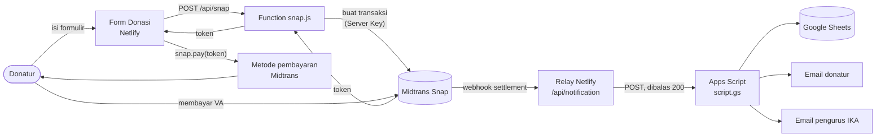
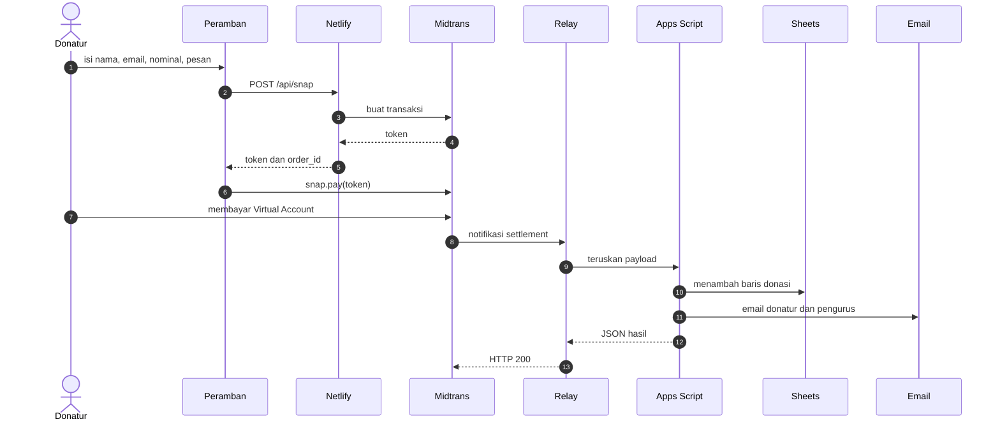
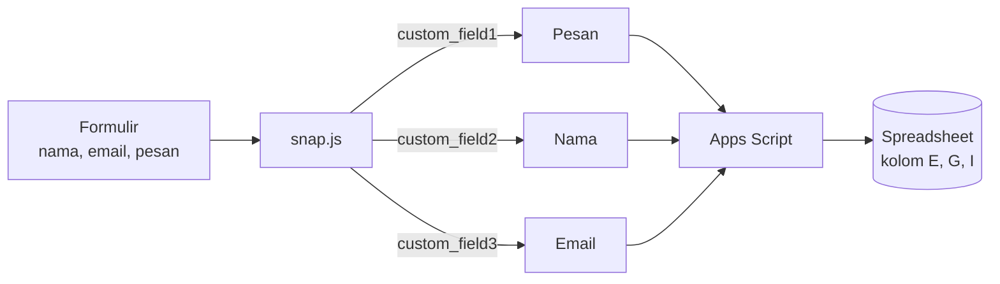

# LAPORAN TUGAS

## SISTEM DONASI BEASISWA IKA UPI BERBASIS WEB DENGAN INTEGRASI *PAYMENT GATEWAY* MIDTRANS (BNI *VIRTUAL ACCOUNT*), PENCATATAN OTOMATIS GOOGLE SHEETS, DAN NOTIFIKASI EMAIL

<br>

| | |
|---|---|
| **Nama** | ⬜ *(isi nama)* |
| **NIM** | ⬜ *(isi NIM)* |
| **Kelas** | ⬜ *(isi kelas)* |
| **Mata Kuliah** | ⬜ *(isi nama mata kuliah)* |
| **Dosen Pengampu** | ⬜ *(isi nama dosen)* |
| **Program Studi** | ⬜ *(isi program studi)* |
| **Tanggal** | 11 November 2026 |

<br>

> **Catatan pemakaian:** tanda ⬜ diisi manual. Diagram Mermaid akan tampil otomatis di GitHub/VS Code;
> jika laporan disalin ke Word, render dulu diagramnya di <https://mermaid.live> lalu tempel sebagai gambar.

---

## DAFTAR ISI

- [BAB I PENDAHULUAN](#bab-i-pendahuluan)
- [BAB II LANDASAN TEORI](#bab-ii-landasan-teori)
- [BAB III ANALISIS DAN PERANCANGAN](#bab-iii-analisis-dan-perancangan)
- [BAB IV IMPLEMENTASI](#bab-iv-implementasi)
- [BAB V PENGUJIAN DAN PEMBAHASAN](#bab-v-pengujian-dan-pembahasan)
- [BAB VI KESIMPULAN DAN SARAN](#bab-vi-kesimpulan-dan-saran)
- [DAFTAR PUSTAKA](#daftar-pustaka)
- [LAMPIRAN](#lampiran)

---

# BAB I PENDAHULUAN

## 1.1 Latar Belakang

Beasiswa merupakan salah satu bentuk dukungan yang paling dibutuhkan mahasiswa, terutama untuk
membiayai kebutuhan akademik seperti uang kuliah, buku, dan biaya penelitian. Ikatan Keluarga
Alumni (IKA) Universitas Pendidikan Indonesia secara berkala menggalang dana dari para alumni
untuk menyalurkannya kembali dalam bentuk beasiswa. Namun, proses penggalangan dana masih
dilakukan secara manual: donatur mentransfer ke rekening tertentu, lalu mengirim bukti transfer
melalui pesan singkat, dan pengurus mencatatnya satu per satu ke dalam spreadsheet.

Pola tersebut menimbulkan beberapa masalah. Pertama, rekapitulasi donasi memakan waktu karena
harus dilakukan manual. Kedua, donatur tidak menerima bukti penerimaan resmi sehingga sulit
memastikan donasinya tercatat. Ketiga, pengurus tidak memiliki cara cepat untuk memverifikasi
apakah suatu transfer benar-benar masuk, sehingga rawan terjadi kesalahan pencatatan maupun
penipuan berupa bukti transfer palsu.

Perkembangan *payment gateway* memungkinkan proses tersebut diotomatisasi. Midtrans menyediakan
layanan *Snap* yang dapat menerbitkan nomor **Virtual Account** secara otomatis dan mengirimkan
**notifikasi HTTP (*webhook*)** ketika pembayaran selesai. Dengan memanfaatkan layanan ini,
sistem dapat mencatat donasi dan mengirim bukti secara otomatis tanpa campur tangan manusia.

Oleh karena itu, pada tugas ini dibangun sebuah sistem donasi berbasis web yang mengintegrasikan
Midtrans Snap dengan Google Sheets dan layanan email. Sistem diberi nama **Donasi Beasiswa IKA UPI**.

## 1.2 Rumusan Masalah

1. Bagaimana merancang formulir donasi berbasis web yang dapat menerbitkan nomor pembayaran (Virtual Account dan metode lain) secara otomatis?
2. Bagaimana memastikan data donatur (nama, email, pesan) tetap terbawa sampai ke proses pencatatan, padahal notifikasi Midtrans tidak menyertakannya?
3. Bagaimana mencatat donasi yang berhasil dibayar ke Google Sheets secara otomatis dan aman dari duplikasi?
4. Bagaimana mengirim bukti donasi ke donatur dan laporan donasi masuk ke pengurus IKA secara otomatis?
5. Bagaimana menerapkan sistem tersebut agar dapat diakses publik tanpa membocorkan *Server Key*?

## 1.3 Tujuan

1. Membangun formulir donasi daring dengan pembayaran BNI Virtual Account melalui Midtrans Snap.
2. Menitipkan data donatur menggunakan `custom_field` agar tidak hilang pada saat notifikasi.
3. Mengimplementasikan *webhook* yang memverifikasi keaslian notifikasi, mencegah duplikasi, dan mencatat data ke spreadsheet.
4. Mengirim dua email otomatis: bukti donasi ke donatur dan laporan ke pengurus IKA.
5. Menerapkan praktik keamanan dasar: *Server Key* hanya berada di sisi server dan notifikasi diverifikasi dengan tanda tangan digital.

## 1.4 Manfaat

**Bagi donatur:** memperoleh nomor Virtual Account resmi dan bukti donasi melalui email.
**Bagi pengurus IKA:** rekapitulasi donasi terbentuk otomatis, tidak perlu mencatat manual.
**Bagi penulis:** memahami alur integrasi *payment gateway*, *webhook*, serta penerapan keamanan dasar pada aplikasi web.

## 1.5 Batasan Masalah

1. Sistem menggunakan **Midtrans Sandbox** (lingkungan uji coba), belum mode produksi.
2. Metode pembayaran mengikuti kanal yang aktif di akun Midtrans (Virtual Account bank,
   e-wallet, QRIS, gerai retail, dan kartu kredit).
3. Donasi bersifat **sekali bayar**, belum mendukung donasi berulang.
4. Data disimpan pada satu spreadsheet Google, belum menggunakan basis data relasional.
5. Belum terdapat dasbor admin dan sistem autentikasi pengguna.
6. Nominal donasi minimal **Rp10.000**.

## 1.6 Metode Pengembangan

Metode yang digunakan adalah **prototyping** dengan tahapan: (1) studi literatur dokumentasi
Midtrans, Netlify, dan Google Apps Script; (2) perancangan alur dan antarmuka; (3) implementasi
bertahap; (4) pengujian *black box* terhadap setiap endpoint; serta (5) perbaikan berdasarkan
hasil pengujian.

---

# BAB II LANDASAN TEORI

## 2.1 *Payment Gateway*

*Payment gateway* adalah layanan perantara yang memproses pembayaran antara pembeli dan penjual.
Layanan ini menangani autentikasi, penerbitan kode pembayaran, verifikasi pembayaran, hingga
pengiriman status transaksi kepada sistem penjual. Dengan layanan ini, pengembang tidak perlu
terhubung langsung ke sistem perbankan.

## 2.2 Midtrans Snap

Snap adalah produk Midtrans berupa antarmuka pembayaran siap pakai. Sistem hanya perlu meminta
**token transaksi** melalui REST API, kemudian menampilkan popup pembayaran menggunakan berkas
`snap.js` dan *Client Key*. Token dibuat menggunakan **Server Key** melalui autentikasi HTTP Basic.

Alur singkatnya:

1. *Backend* mengirim data transaksi ke `POST /snap/v1/transactions`.
2. Midtrans membalas `token` dan `redirect_url`.
3. *Frontend* memanggil `snap.pay(token)` sehingga muncul pilihan pembayaran.
4. Setelah pembayaran selesai, Midtrans mengirim notifikasi ke URL yang didaftarkan.

## 2.3 BNI *Virtual Account*

*Virtual Account* (VA) adalah nomor rekening virtual yang dibuat khusus untuk satu transaksi.
Donatur membayar ke nomor tersebut melalui ATM, *mobile banking*, atau kanal lain. Karena nomornya
unik, sistem dapat mengenali pembayaran mana yang telah diselesaikan. Nomor VA memiliki masa
berlaku; apabila tidak dibayar sampai batas waktu, transaksi berstatus `expire`.

## 2.4 *Webhook* / HTTP Notification

*Webhook* adalah mekanisme pemberitahuan dari server penyedia layanan ke sistem kita melalui
permintaan HTTP. Pada Midtrans, notifikasi dikirim setiap kali status transaksi berubah
(`pending`, `settlement`, `expire`, dan sebagainya) beserta data transaksi dan `signature_key`.

Sistem penerima **wajib membalas HTTP 200** agar dianggap berhasil. Apabila gagal, Midtrans akan
mengirim ulang notifikasi yang sama beberapa kali sehingga penerima harus bersifat **idempoten**
(memproses notifikasi berulang tanpa menghasilkan data ganda).

## 2.5 Tanda Tangan Digital SHA-512

Karena URL *webhook* bersifat publik, siapa pun dapat mengirim data palsu. Midtrans menyertakan
`signature_key` yang dapat diverifikasi dengan rumus:

```
signature_key = SHA512(order_id + status_code + gross_amount + SignatureSecretKey)
```

Jika hasil perhitungan tidak sama dengan nilai yang dikirim, notifikasi ditolak.

## 2.6 *Serverless Function*

*Serverless function* adalah fungsi yang dijalankan hanya ketika ada permintaan, tanpa server yang
menyala terus-menerus. Layanan ini digunakan untuk menyimpan *Server Key* dan membuat token
Midtrans. Pada tugas ini dipakai **Netlify Functions**.

## 2.7 Google Apps Script

Google Apps Script adalah lingkungan skrip berbasis JavaScript yang terintegrasi dengan produk
Google. Skrip dapat di-*deploy* sebagai **Web App** yang menerima permintaan HTTP melalui fungsi
`doPost(e)`, lalu menulis data menggunakan `SpreadsheetApp` dan mengirim email menggunakan `MailApp`.

Satu karakteristik penting: Web App Apps Script **selalu membalas HTTP 302** (mengalihkan ke
`script.googleusercontent.com`), sehingga perlu perantara agar dapat membalas `200` kepada Midtrans.

## 2.8 Idempotensi

Idempotensi berarti operasi yang sama, bila dijalankan berulang, memberikan hasil akhir yang sama.
Pada sistem ini idempotensi diterapkan dengan memeriksa apakah `order_id` sudah ada di spreadsheet
sebelum menambah baris baru.

---

# BAB III ANALISIS DAN PERANCANGAN

## 3.1 Kebutuhan Fungsional

| Kode | Kebutuhan | Keterangan |
|---|---|---|
| F-01 | Formulir donasi | Nama, email, nominal, dan pesan |
| F-02 | Validasi nominal minimal | Rp10.000, divalidasi di sisi klien dan server |
| F-03 | Pembuatan transaksi | Token Snap; metode mengikuti kanal aktif di akun Midtrans |
| F-04 | Penomoran otomatis | Format `BNI-IKA-<timestamp>-<random>` |
| F-05 | Penitipan data donatur | `metadata` dan `custom_field1..4` (nama, email, pesan, angkatan, prodi, NIM) |
| F-06 | Penerimaan notifikasi | Endpoint publik yang meneruskan ke Apps Script |
| F-07 | Verifikasi keaslian | Pemeriksaan `signature_key` SHA-512 |
| F-08 | Penyaringan status | Hanya `settlement` (dan `capture`/`accept`) yang dicatat |
| F-09 | Pencegahan duplikasi | Pemeriksaan `order_id` pada kolom B |
| F-10 | Pencatatan otomatis | Satu baris per donasi berisi sembilan kolom |
| F-11 | Email ke donatur | Bukti donasi dan rincian transaksi |
| F-12 | Email ke pengurus | Laporan donasi masuk |

## 3.2 Kebutuhan Non-Fungsional

| Aspek | Kebutuhan |
|---|---|
| Keamanan | *Server Key* tidak pernah dikirim ke peramban; notifikasi diverifikasi tanda tangan |
| Ketersediaan | Berjalan pada layanan awan (Netlify) sehingga dapat diakses publik |
| Responsivitas | Tampilan menyesuaikan layar ponsel dan desktop |
| Usabilitas | Nominal cepat (25rb–250rb), format ribuan otomatis, pesan kesalahan di dekat kolom |
| Pemeliharaan | Setiap perubahan kode dapat di-*deploy* ulang dengan satu perintah |

## 3.3 Arsitektur Sistem



Sistem terdiri atas lima komponen dengan pembagian tugas yang tegas: peramban hanya menangani
antarmuka, fungsi Netlify memegang kunci rahasia, Midtrans menangani pembayaran, relay menyesuaikan
kode balasan, dan Apps Script menjadi backend data.

## 3.4 Alur Sistem



## 3.5 Alur Data Donatur

Notifikasi Midtrans **tidak** memuat `customer_details`, sehingga nama dan email berpotensi hilang.
Solusi yang dipakai adalah menitipkan data pada `custom_field` yang selalu dikembalikan.



## 3.6 Rancangan Struktur Data

Data disimpan pada satu lembar kerja dengan sembilan kolom:

| Kolom | Nama Data | Tipe | Sumber |
|---|---|---|---|
| A | Timestamp | Tanggal | `new Date()` saat webhook diterima |
| B | Order ID | Teks | `order_id` (kunci anti-duplikat) |
| C | Bank | Teks | `va_numbers[0].bank` |
| D | Nomor VA | Teks | `va_numbers[0].va_number` |
| E | Nama Donatur | Teks | `custom_field2` |
| F | Nominal | Angka | `gross_amount` |
| G | Pesan | Teks | `custom_field1` |
| H | Status | Teks | Tetap `LUNAS / SUCCESS` |
| I | Email | Teks | `custom_field3` |

## 3.7 Rancangan Antarmuka

Formulir dirancang satu kolom dengan urutan: identitas donatur, nominal, pesan, lalu tombol
pembayaran. Unsur pentingnya:

1. **Input nominal** berformat ribuan otomatis dan berawalan "Rp".
2. **Tombol nominal cepat** 25rb, 50rb, 100rb, 250rb.
3. **Validasi sebaris** (pesan merah di bawah kolom), bukan `alert`, agar tidak mengganggu.
4. **Banner status backend** hanya muncul bila ada masalah konfigurasi.
5. **Keadaan tombol** berubah menjadi "Membuat Virtual Account…" dan dinonaktifkan saat memproses.

## 3.8 Rancangan Keamanan

| Ancaman | Penanganan |
|---|---|
| *Server Key* dicuri dari kode halaman | Kunci tidak pernah dikirim ke peramban; hanya ada di fungsi server |
| Notifikasi palsu | Verifikasi `signature_key` SHA-512 sebelum data diproses |
| Data ganda akibat notifikasi berulang | Pemeriksaan `order_id` + `LockService` |
| Penulisan bersamaan | Kunci proses (*script lock*) maksimal 30 detik |
| Nominal tidak wajar | Validasi minimal Rp10.000 di klien dan server |

---

# BAB IV IMPLEMENTASI

## 4.1 Lingkungan Implementasi

| Komponen | Teknologi |
|---|---|
| Bahasa | JavaScript (Node.js 22), HTML, CSS tanpa framework |
| Antarmuka | HTML tunggal `index.html` |
| Backend lokal | `server.js` (HTTP bawaan Node.js) |
| Backend produksi | Netlify Functions (2 situs: form dan relay) |
| Pembayaran | Midtrans Snap API — semua kanal aktif |
| Pencatatan | Google Sheets melalui `SpreadsheetApp` |
| Email | `MailApp` (Google Apps Script) |
| Editor | Visual Studio Code, PowerShell |

## 4.2 Struktur Berkas

```
ASAH_5/
├─ index.html                 # formulir donasi
├─ server.js                  # backend lokal (/api/snap, /api/health)
├─ cek-key.js                 # utilitas pengujian kunci Midtrans
├─ cek-webhook.js             # pemeriksa versi webhook + pengirim tes
├─ script.gs                  # webhook Apps Script
├─ appsscript.json            # manifest izin
├─ deploy.ps1                 # satu perintah deploy ulang
├─ .env                       # kunci rahasia (tidak diunggah)
├─ netlify-site/              # situs formulir
│  ├─ public/index.html
│  └─ netlify/functions/{snap,health,_config}.js
└─ netlify-relay/             # situs relay notifikasi
   └─ netlify/functions/notification.js
```

## 4.3 Pembuatan Transaksi

Fungsi `snap.js` memvalidasi masukan, menyusun `order_id`, lalu memanggil Midtrans.

```js
if (amount < MIN_AMOUNT) {
  return json(400, { error: `Nominal minimal Rp${MIN_AMOUNT.toLocaleString('id-ID')}` });
}

const orderId = `BNI-IKA-${Date.now()}-${Math.floor(Math.random() * 1000)}`;

const payload = {
  transaction_details: { order_id: orderId, gross_amount: amount },
  customer_details: { first_name: customerName, email: customerEmail },
  enabled_payments: ['bni_va'],
  custom_field1: note,          // pesan donatur
  custom_field2: customerName,  // nama donatur
  custom_field3: customerEmail, // email donatur
  custom_field4: isAlumni ? `ALUMNI|${angkatan}|${prodi}|${nim}` : 'UMUM',
  metadata: {                   // jalur utama, ikut kembali di notifikasi
    nama: customerName, email: customerEmail, pesan: note,
    kategori: isAlumni ? 'ALUMNI' : 'UMUM',
    angkatan, prodi, nim
  },
};
```

Permintaan dikirim dengan autentikasi Basic menggunakan *Server Key*:

```js
Authorization: 'Basic ' + Buffer.from(`${SERVER_KEY}:`).toString('base64')
```

Hasilnya berupa `token` yang dikirim ke peramban untuk memanggil `snap.pay(token)`.

## 4.4 Penerimaan Notifikasi

Fungsi `doPost` pada `script.gs` menjalankan enam langkah berurutan.

```js
function doPost(e) {
  const lock = LockService.getScriptLock();
  lock.waitLock(30000);
  try {
    const data = JSON.parse(e.postData.contents);

    if (!verifySignature(data)) {
      return json({ status: 'error', message: 'Signature tidak valid' });
    }

    const lunas = data.transaction_status === 'settlement' ||
      (data.transaction_status === 'capture' && data.fraud_status === 'accept');

    if (!lunas) return json({ status: 'OK', message: 'Belum lunas, tidak dicatat' });

    const sheet = getSheet();
    if (sudahTercatat(sheet, data.order_id)) {
      return json({ status: 'OK', message: 'Order sudah tercatat, dilewati' });
    }

    const donor = ambilDataDonatur(data);
    sheet.appendRow([new Date(), data.order_id, donor.bank, donor.vaNumber,
                     donor.name, donor.amount, donor.note, 'LUNAS / SUCCESS', donor.email]);

    return json({ status: 'OK', email: kirimNotifikasi(donor, data.order_id) });
  } finally {
    lock.releaseLock();
  }
}
```

## 4.5 Verifikasi Tanda Tangan

```js
const raw = `${data.order_id}${data.status_code}${data.gross_amount}${secret}`;
const hash = Utilities.computeDigest(
  Utilities.DigestAlgorithm.SHA_512, raw, Utilities.Charset.UTF_8
).map((b) => ('0' + (b & 0xff).toString(16)).slice(-2)).join('');

const cocok = hash === String(data.signature_key).toLowerCase();
```

Nilai `secret` diambil dari *Script Properties* `MIDTRANS_SIGNATURE_KEY`, bukan ditulis di kode.

## 4.6 Pencegahan Duplikasi

```js
function sudahTercatat(sheet, orderId) {
  const lastRow = sheet.getLastRow();
  if (lastRow < 1) return false;
  const ids = sheet.getRange(1, 2, lastRow, 1).getValues();
  return ids.some((row) => String(row[0]).trim() === String(orderId).trim());
}
```

Pemeriksaan dilakukan di dalam blok `LockService` agar dua notifikasi yang datang bersamaan tidak
sama-sama lolos.

## 4.7 Pengiriman Email

Dua email dikirim dari satu fungsi `kirimNotifikasi`, masing-masing dengan `try/catch` terpisah
supaya kegagalan salah satu tidak menggagalkan yang lain.

```js
function kirimNotifikasi(donor, orderId) {
  const hasil = { ke_ika: false, ke_donatur: false };
  const emailIka = ambilEmailIka();

  if (CONFIG.SEND_IKA_EMAIL && emailIka) {
    MailApp.sendEmail({
      to: emailIka,
      subject: `[Donasi Masuk] ${donor.name} - ${rupiah(donor.amount)}`,
      htmlBody: templateIka(donor, orderId),
    });
    hasil.ke_ika = true;
  }

  if (CONFIG.SEND_DONOR_EMAIL && donor.email) {
    MailApp.sendEmail({
      to: donor.email,
      subject: `Terima kasih, ${donor.name}!`,
      htmlBody: templateDonatur(donor, orderId),
      replyTo: emailIka,
    });
    hasil.ke_donatur = true;
  }

  return hasil;
}
```

## 4.8 Relay 302 Menjadi 200

```js
const upstream = await fetch(GAS_URL, {
  method: 'POST',
  headers: { 'Content-Type': 'application/json' },
  body,              // payload Midtrans diteruskan apa adanya
  redirect: 'follow', // mengikuti 302 Apps Script
});

const hasil = JSON.parse(await upstream.text());

if (hasil.status === 'error') {
  return json(502, { ok: false });   // Midtrans diminta mengulang
}
return json(200, { ok: true });
```

## 4.9 Deployment

| Komponen | Cara |
|---|---|
| Formulir | `.\deploy.ps1` (menyalin `index.html`, memeriksa sintaks, `netlify deploy --prod`) |
| Relay | `.\deploy.ps1 relay` |
| Apps Script | Tempel `script.gs` → *Deploy* → *Manage deployments* → *Edit* → **New version** |

Kesalahan yang paling sering terjadi adalah menekan *Save* pada editor Apps Script tanpa membuat
*New version*, sehingga Web App tetap menjalankan kode lama.

## 4.10 Konfigurasi

| Lokasi | Nama | Fungsi |
|---|---|---|
| `.env` | `MIDTRANS_SERVER_KEY` | Kunci server untuk membuat token |
| `.env` | `MIDTRANS_CLIENT_KEY` | Kunci klien untuk `snap.js` |
| `.env` | `MIDTRANS_SIGNATURE_KEY` | Verifikasi tanda tangan (pengujian) |
| Script Properties | `MIDTRANS_SIGNATURE_KEY` | Verifikasi tanda tangan (produksi) |
| Script Properties | `EMAIL_IKA` | Email pengurus penerima laporan |
| Dasbor Midtrans | *Payment Notification URL* | `https://relay-donasi-ika-upi.netlify.app/api/notification` |

---

# BAB V PENGUJIAN DAN PEMBAHASAN

## 5.1 Metode Pengujian

Pengujian dilakukan dengan metode **black box**, yaitu menguji masukan dan keluaran setiap
endpoint tanpa memeriksa kode secara internal. Alat yang digunakan: `curl`, peramban, dan skrip
Node.js `cek-webhook.js` yang mengirim notifikasi bertanda tangan valid.

## 5.2 Skenario dan Hasil

| No | Skenario | Masukan | Hasil yang Diharapkan | Hasil |
|---|---|---|---|---|
| 1 | Halaman utama dibuka | `GET /` | HTTP 200 | **Sesuai** |
| 2 | Status backend | `GET /api/health` | `{ok: true, mode: sandbox}` | **Sesuai** |
| 3 | Nominal di bawah batas | `amount: 5000` | HTTP 400, pesan minimal | **Sesuai** — `{"error":"Nominal minimal Rp10.000"}` |
| 4 | Nominal memenuhi batas | `amount: 25000` | HTTP 200 + token | **Sesuai** — token dibuat |
| 5 | Relay aktif | `GET /api/notification` | HTTP 200 | **Sesuai** |
| 6 | Notifikasi bertanda tangan valid | POST `settlement` | Diterima dan dicatat | **Sesuai** — baris bertambah, `{"status":"OK"}` |
| 7 | Pengujian fungsi email | `tesEmail()` di editor | Dua email terkirim | **Sesuai** — `{"ke_ika":true,"ke_donatur":true}` |
| 8 | Notifikasi tanda tangan salah | `signature_key` diubah | Ditolak | **Sesuai** — `"Signature tidak valid"` |
| 9 | Notifikasi diulang | `order_id` sama | Dilewati | **Sesuai** — `"Order sudah tercatat, dilewati"` |
| 10 | Status belum lunas | `pending` | Tidak dicatat | **Sesuai** |
| 11 | Data donatur di spreadsheet | Nama + email dari formulir | Kolom E dan I terisi benar | **Sesuai** |

## 5.3 Kendala dan Solusi

| Kendala | Penyebab | Solusi |
|---|---|---|
| Midtrans membalas `401 Unauthorized` | Kunci yang dipakai adalah *Signature Secret Key*, bukan *Server Key* | Mengambil kunci dari tabel **Server Keys** |
| Notifikasi dianggap gagal oleh Midtrans | Apps Script selalu membalas `302` | Menambahkan relay Netlify yang membalas `200` |
| Nama di spreadsheet menjadi "Hamba Allah" | Notifikasi tidak memuat data pelanggan | Data dititipkan pada `custom_field1..3` |
| Baris masuk tetapi email tidak terkirim | Web App masih menjalankan versi *deployment* lama | *Manage deployments* → *Edit* → *New version* → *Deploy* |
| Layar putih / status `401` pada relay | Proteksi akses Netlify aktif | Menonaktifkan `sso_login` pada pengaturan situs |
| Deploy membuat situs baru | Berkas `.netlify/state.json` hilang atau ber-BOM | Skrip deploy menulis ulang state dengan UTF-8 tanpa BOM |
| Izin email ditolak | *Scope* `script.send_mail` belum disetujui | Menjalankan `tesEmail` lalu memilih **Allow** |

## 5.4 Pembahasan

**Mengapa memakai relay.** Web App Apps Script selalu membalas `302`, sedangkan Midtrans hanya
menerima `200`. Relay tidak menyimpan data apa pun; tugasnya hanya meneruskan permintaan dan
menyesuaikan kode balasan. Relay juga memeriksa isi balasan Apps Script: bila berisi
`status: "error"`, relay membalas `502` agar Midtrans mencoba ulang, sehingga kegagalan tidak
hilang diam-diam.

**Mengapa memakai `custom_field`.** Notifikasi Midtrans tidak menyertakan `customer_details`.
Tanpa `custom_field`, sistem hanya mengetahui nominal dan `order_id`, sehingga tidak dapat mengirim
email maupun mencantumkan nama donatur.

**Mengapa validasi dilakukan dua kali.** Validasi di peramban memberi umpan balik cepat, sedangkan
validasi di fungsi server mencegah tindakan melewati antarmuka (misalnya melalui *developer tools*).

**Mengapa satu baris ditulis sebelum email dikirim.** Data keuangan lebih kritis daripada notifikasi
email. Bila pengiriman email gagal, catatan donasi tetap tersimpan dan dapat ditindaklanjuti.

## 5.5 Keterbatasan Sistem

1. Belum ada mekanisme rekonsiliasi otomatis; bila notifikasi gagal total, donasi tidak tercatat.
2. Google Sheets bukan basis data relasional; tidak mendukung kueri dan rawan salah edit manual.
3. Kuota pengiriman email Apps Script terbatas (sekitar 100 email/hari untuk akun Gmail biasa).
4. Belum ada autentikasi admin, pembatasan laju permintaan, maupun CAPTCHA.
5. Masih menggunakan Midtrans Sandbox sehingga belum dapat menerima uang sungguhan.

---

# BAB VI KESIMPULAN DAN SARAN

## 6.1 Kesimpulan

1. Sistem donasi berbasis web berhasil dibangun dan dapat diakses publik melalui Netlify.
2. Integrasi Midtrans Snap berhasil menerbitkan BNI Virtual Account dengan pembatasan metode pada `bni_va`.
3. Data donatur tetap utuh sampai ke spreadsheet dengan memanfaatkan `custom_field1..3`.
4. Notifikasi Midtrans berhasil diverifikasi menggunakan SHA-512, disaring berdasarkan status, dan
   dilindungi dari duplikasi melalui pemeriksaan `order_id` serta `LockService`.
5. Dua email otomatis (donatur dan pengurus) berhasil dikirim setelah status transaksi dinyatakan lunas.
6. *Server Key* tidak pernah dikirim ke peramban sehingga pembuatan transaksi hanya dapat dilakukan
   melalui server.

## 6.2 Saran

1. Mengganti Google Sheets dengan basis data relasional (misalnya PostgreSQL/Supabase).
2. Menambahkan pekerjaan rekonsiliasi harian melalui API status Midtrans untuk menangkap notifikasi yang hilang.
3. Menambahkan dasbor admin dengan autentikasi untuk verifikasi dan ekspor data.
4. Menerapkan pembatasan laju permintaan dan CAPTCHA pada endpoint pembuatan transaksi.
5. Mendukung donasi berulang, beberapa program beasiswa, serta notifikasi WhatsApp.
6. Melengkapi persiapan mode produksi: dokumen badan usaha, rekening penampung, kebijakan privasi, dan pembukuan.

---

# DAFTAR PUSTAKA

1. Midtrans. *Snap API Documentation*. <https://docs.midtrans.com/docs/snap-snap-integration-guide> (diakses 11 November 2026).
2. Midtrans. *HTTP Notification*. <https://docs.midtrans.com/docs/https-notification-webhooks> (diakses 11 November 2026).
3. Google. *Apps Script — Web Apps*. <https://developers.google.com/apps-script/guides/web> (diakses 11 November 2026).
4. Google. *Apps Script — MailApp*. <https://developers.google.com/apps-script/reference/mail/mail-app> (diakses 11 November 2026).
5. Netlify. *Netlify Functions*. <https://docs.netlify.com/functions/overview/> (diakses 11 November 2026).
6. Node.js. *Node.js Documentation*. <https://nodejs.org/docs/latest/api/> (diakses 11 November 2026).
7. OWASP Foundation. *OWASP Top 10*. <https://owasp.org/www-project-top-ten/> (diakses 11 November 2026).

---

# LAMPIRAN

## Lampiran A — Cara Menjalankan Secara Lokal

```powershell
cd "D:\Kuliah\semester 5\data management\Tugas\ASAH\ASAH_5"
node cek-key.js       # memastikan Server Key valid
node server.js        # lalu buka http://localhost:3000
```

## Lampiran B — Berkas Konfigurasi

```ini
# .env
MIDTRANS_SERVER_KEY=SB-Mid-server-xxxxxxxx
MIDTRANS_CLIENT_KEY=Mid-client-xxxxxxxx
MIDTRANS_IS_PRODUCTION=false
MIDTRANS_SIGNATURE_KEY=Mid-server-xxxxxxxx
PORT=3000
```

## Lampiran C — Alamat Sistem

| Bagian | Alamat |
|---|---|
| Formulir donasi | https://donasi-beasiswa-ika-upi.netlify.app |
| Relay notifikasi | https://relay-donasi-ika-upi.netlify.app/api/notification |
| Web App Apps Script | `https://script.google.com/macros/s/AKfycb…/exec` |
| Repositori | https://github.com/madgeer/portal-beasiswa-ika |

## Lampiran D — Perintah Pengujian

```powershell
curl.exe -s -o NUL -w "%{http_code}" https://donasi-beasiswa-ika-upi.netlify.app/
curl.exe -s https://donasi-beasiswa-ika-upi.netlify.app/api/health
node cek-webhook.js --email
```
