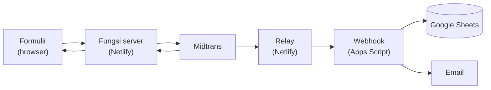
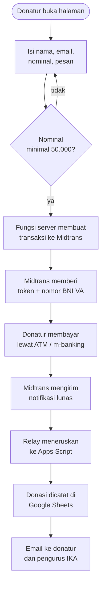
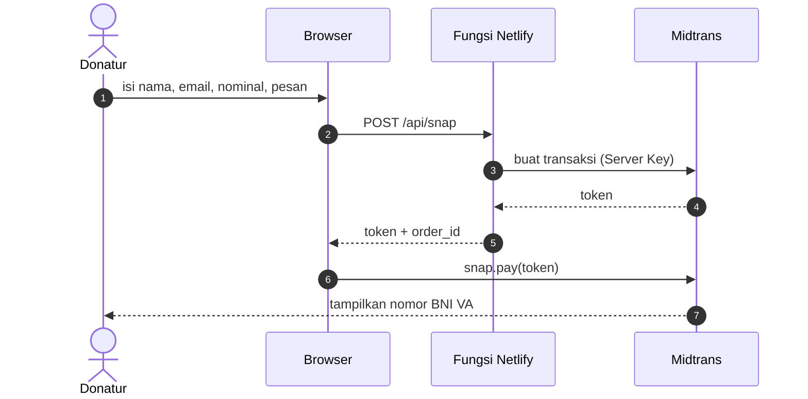
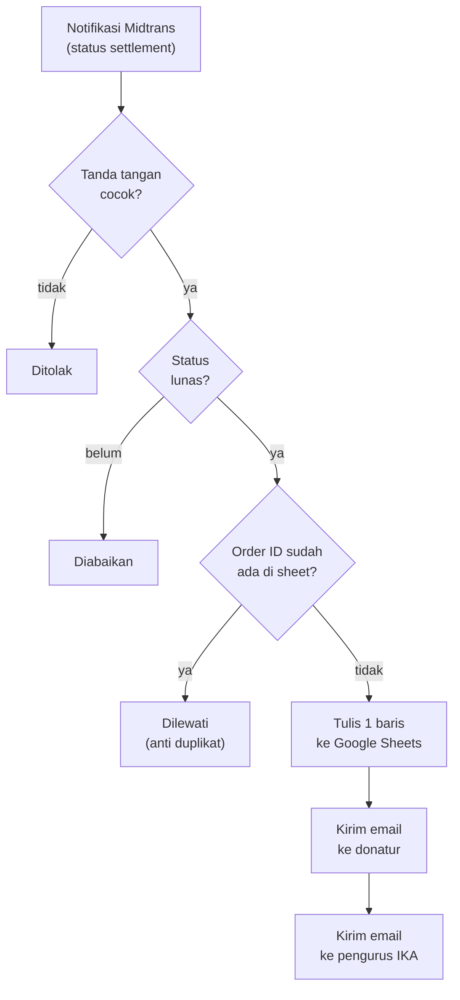
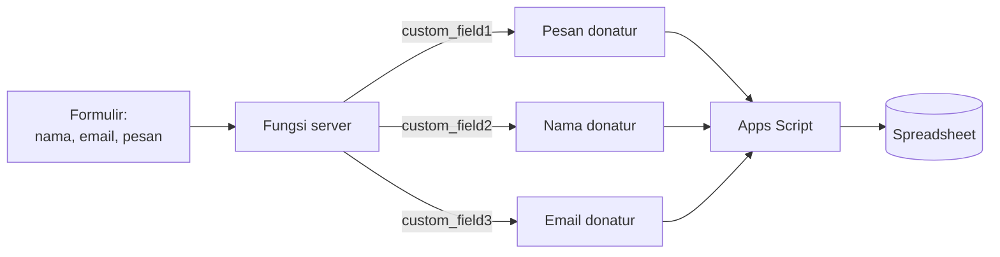
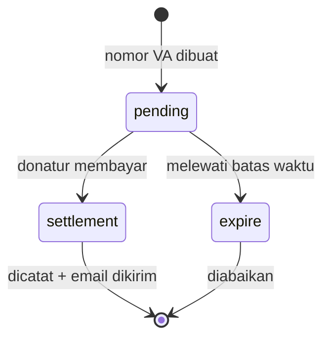
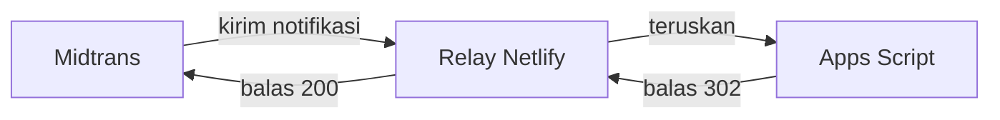
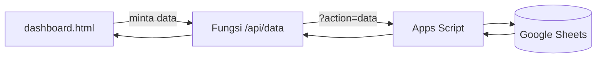

# Aplikasi Donasi Beasiswa Alumni IKA UPI

| | |
|---|---|
| **Nama** | ⬜ *(isi nama)* |
| **NIM** | ⬜ *(isi NIM)* |
| **Kelas** | ⬜ *(isi kelas)* |
| **Mata Kuliah** | ⬜ *(isi mata kuliah)* |
| **Repositori** | https://github.com/madgeer/portal-beasiswa-ika |

---

## 1. Gambaran Singkat

Aplikasi ini adalah **formulir donasi online** untuk mengumpulkan dana beasiswa dari alumni
Universitas Pendidikan Indonesia. Donatur membuka satu halaman web, mengisi nama, email, nominal,
dan pesan, lalu membayar melalui **BNI Virtual Account** yang dibuat otomatis oleh Midtrans.

Setelah pembayaran selesai, aplikasi **mencatat donasi ke Google Sheets** dan **mengirim dua email**:
bukti donasi ke donatur dan laporan ke pengurus IKA. Tidak ada proses pencatatan manual.

Tiga hal yang membuat aplikasi ini berbeda dari formulir biasa:

| | |
|---|---|
| **Nomor pembayaran unik** | setiap donasi mendapat nomor Virtual Account sendiri |
| **Otomatis** | rekap dan email dibuat sendiri setelah pembayaran masuk |
| **Aman** | kunci rahasia tidak pernah dikirim ke peramban dan setiap notifikasi diverifikasi |

---

## 2. Bagian-Bagian Aplikasi

Aplikasi terdiri dari lima bagian yang saling terhubung:

| Bagian | Letak | Tugas |
|---|---|---|
| **Formulir** | browser donatur | menampilkan isian dan tombol bayar |
| **Fungsi server** | Netlify | membuat transaksi ke Midtrans (memegang kunci rahasia) |
| **Midtrans** | server Midtrans | menerbitkan nomor VA dan memproses pembayaran |
| **Relay** | Netlify | meneruskan notifikasi Midtrans ke Google |
| **Webhook** | Google Apps Script | mencatat ke spreadsheet dan mengirim email |



---

## 3. Alur Utama Aplikasi

Alur lengkapnya dibagi menjadi dua fase: **sebelum dibayar** (langsung, beberapa detik) dan
**sesudah dibayar** (otomatis, dipicu oleh Midtrans).



---

## 4. Fase 1 — Saat Donatur Mengisi Form



Penjelasannya:

1. **Isi formulir.** Nama dan email wajib diisi karena akan dipakai untuk bukti donasi. Nominal
   minimal Rp50.000, dengan tombol cepat 50rb, 100rb, 250rb, dan 500rb.
2. **Kirim ke server.** Browser mengirim data ke `/api/snap`. Browser **tidak** tahu kunci rahasia
   Midtrans; ia hanya bertanya kepada server.
3. **Server membuat transaksi.** Fungsi di Netlify menyusun nomor pesanan
   `BNI-IKA-<waktu>-<acak>`, lalu meminta token ke Midtrans menggunakan *Server Key*.
4. **Token dikembalikan.** Midtrans membalas token, lalu browser menampilkan popup pembayaran.
5. **Donatur membayar.** Nomor Virtual Account bisa dibayar lewat ATM, m-banking, atau aplikasi bank.

---

## 5. Fase 2 — Setelah Pembayaran

Di sini donatur sudah menutup halaman, tetapi aplikasi tetap bekerja. Midtrans mengirim
**notifikasi (webhook)** ke alamat relay, lalu relay meneruskannya ke Apps Script.



Urutan pemeriksaan ini penting:

| Pemeriksaan | Tujuan |
|---|---|
| tanda tangan | memastikan notifikasi benar-benar dari Midtrans, bukan kiriman orang lain |
| status lunas | notifikasi `pending` dan `expire` bukan donasi, jadi tidak dicatat |
| Order ID ganda | Midtrans bisa mengirim notifikasi yang sama berkali-kali, data tidak boleh dobel |

Angka **Rp50.000** dan status **settlement** adalah dua hal yang paling menentukan: nominal di bawah
batas ditolak sebelum transaksi dibuat, dan hanya transaksi lunas yang dianggap donasi.

---

## 6. Perjalanan Data Donatur

Notifikasi Midtrans hanya berisi nominal, nomor VA, dan nomor pesanan — **nama dan email donatur
tidak ikut**. Karena itu, saat membuat transaksi, server menitipkan data tersebut ke tiga kolom
titipan (`custom_field`) yang pasti dikembalikan Midtrans.



Hasil akhirnya satu baris berisi sembilan kolom:

| Kolom | Isi |
|---|---|
| A | waktu donasi masuk |
| B | nomor pesanan (Order ID) |
| C | bank (BNI) |
| D | nomor Virtual Account |
| E | **nama donatur** |
| F | nominal |
| G | pesan donatur |
| H | status (LUNAS) |
| I | **email donatur** |

Tanpa `custom_field`, kolom E akan berisi "Hamba Allah" karena nama tidak pernah sampai ke webhook.

---

## 7. Status Pembayaran

Satu transaksi memiliki beberapa kemungkinan status. Aplikasi hanya peduli pada satu status:
**settlement** (lunas).



| Status | Arti | Tindakan aplikasi |
|---|---|---|
| `pending` | nomor VA sudah terbit, belum dibayar | tidak dicatat |
| `settlement` | pembayaran berhasil | dicatat + dua email |
| `expire` | melewati batas waktu | diabaikan |
| `deny` / `cancel` | gagal atau dibatalkan | diabaikan |

---

## 8. Kenapa Ada Relay

Google Apps Script selalu membalas **HTTP 302** (pengalihan), sedangkan Midtrans hanya mau menerima
**HTTP 200**. Kalau dibalas 302, Midtrans menganggap notifikasi gagal dan mengirim email peringatan.

Relay adalah fungsi kecil di Netlify yang berdiri di tengah:



Relay tidak menyimpan data apa pun. Tugasnya hanya dua: meneruskan isi notifikasi dan mengubah kode
balasan agar diterima Midtrans. Kalau Apps Script melaporkan error, relay membalas `502` supaya
Midtrans mencoba lagi — jadi kegagalan tidak hilang diam-diam.

---

## 9. Struktur Berkas

```
ASAH_5/
├─ index.html          formulir donasi (tampilan)
├─ server.js           backend untuk dijalankan di komputer sendiri
├─ script.gs           webhook: catat ke sheet + kirim email
├─ netlify-site/       situs formulir (fungsi /api/snap dan /api/health)
├─ netlify-relay/      relay notifikasi (fungsi /api/notification)
└─ deploy.ps1          perintah deploy ulang
```

Alamat yang dipakai:

| Bagian | Alamat |
|---|---|
| Formulir | https://donasi-beasiswa-ika-upi.netlify.app |
| Relay | https://relay-donasi-ika-upi.netlify.app/api/notification |

---

## 10. Keamanan

| Risiko | Cara ditangani |
|---|---|
| Kunci rahasia dicuri dari halaman web | kunci hanya ada di server, tidak pernah dikirim ke browser |
| Notifikasi palsu | diperiksa dengan tanda tangan SHA-512 dari Midtrans |
| Data dobel | dicek berdasarkan Order ID sebelum menulis baris |
| Dua notifikasi datang bersamaan | penulisan dikunci (`LockService`) |
| Nominal tidak wajar | minimal Rp50.000 divalidasi di browser dan di server |

---

## 11. Hasil Pengujian

| Yang diuji | Hasil |
|---|---|
| Halaman formulir dibuka | berhasil (HTTP 200) |
| Donasi Rp10.000 | ditolak, "Nominal minimal Rp50.000" |
| Donasi Rp50.000 | berhasil, dapat token dan nomor VA |
| Relay notifikasi | aktif (HTTP 200) |
| Notifikasi dengan tanda tangan salah | ditolak |
| Notifikasi dikirim dua kali | yang kedua dilewati |
| Email donatur dan pengurus | terkirim (`ke_ika: true`, `ke_donatur: true`) |

---

## 12. Dashboard Data

Selain formulir, tersedia halaman dashboard untuk melihat isi spreadsheet dalam bentuk yang
lebih mudah dibaca. Halaman ini menampilkan total donasi, jumlah donasi, rata-rata, donasi bulan
ini, grafik 14 hari terakhir, sebaran nominal, serta tabel donasi yang bisa dicari dan diekspor
ke CSV.



Alurnya sederhana: dashboard tidak membaca spreadsheet secara langsung, tetapi meminta data
dalam bentuk JSON kepada Apps Script. Cara ini dipilih agar kunci dan alamat spreadsheet tidak
berada di halaman web.

Karena data memuat nama dan email donatur, aksesnya dilindungi kunci (`DASHBOARD_KEY`). Kunci
diperiksa di sisi server, sehingga menebak alamat halaman saja tidak cukup untuk melihat data.

---

## 13. Kesimpulan

Aplikasi donasi ini mengotomatisasi tiga pekerjaan yang sebelumnya dilakukan manual: **membuat nomor
pembayaran**, **mencatat donasi**, dan **mengirim bukti donasi**. Alurnya sederhana — isi formulir,
bayar, lalu sistem bekerja sendiri.

Bagian terpenting bukan tampilan form, melainkan **webhook**: di situlah data donasi masuk, diperiksa
keasliannya, dicegah dari duplikasi, lalu disimpan. Relay dan `custom_field` ada bukan tanpa alasan,
tetapi untuk mengatasi dua keterbatasan teknis Midtrans dan Apps Script.

Pengembangan berikutnya yang paling masuk akal adalah mengganti Google Sheets dengan basis data
sungguhan dan menambahkan dasbor admin, agar aplikasi ini dapat dipakai untuk donasi nyata.
